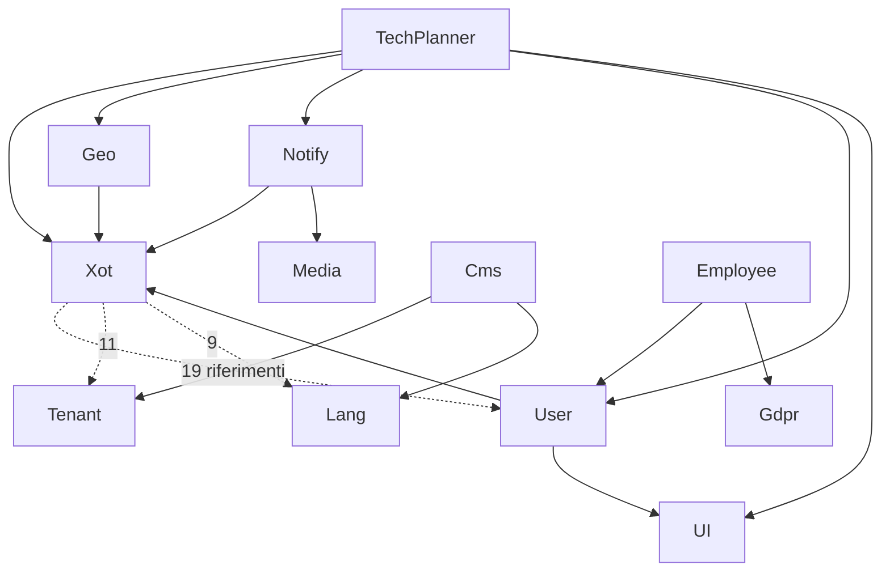

# Architettura, moduli e dipendenze

TechPlanner è un'applicazione Laravel modulare (Laraxot): un modulo di prodotto, `TechPlanner`, appoggiato su
16 moduli condivisi e 5 temi. Il codice vive in `laravel/`; la wiki degli agenti è un symlink verso il repo privato
`bashscripts_fila5` (`docs/wiki/*` → `bashscripts/ai/wiki/*`).

## Stack (dal `composer.lock`, verificato)

| Componente | Versione | Nota |
|---|---|---|
| PHP richiesto dal lock | ≥ 8.4.1 | `composer.json` dichiara `^8.2` e `platform.php ^8.3`: **incoerente** (gap DEV-02) |
| laravel/framework | 13.39.0 | `laravel/CLAUDE.md` dichiara ancora Laravel 12 |
| filament/filament | 5.11.0 | `laravel/CLAUDE.md` dichiara v4 |
| livewire/livewire | 4.4.8 | `laravel/CLAUDE.md` dichiara v3 |
| nwidart/laravel-modules | 13.3.0 | dipendenze dei moduli unite con `composer-merge-plugin` (`Modules/*/composer.json`) |
| pestphp/pest · larastan · phpstan | 5.3.4 · 3.13.2 · 2.3.3 | |
| spatie/laravel-permission · folio · volt | 8.3.2 · 1.2.0 · 1.11.2 | |

## Strati

```
Temi (Two servito, Sixteen, Zero, Meetup, TwentyOne)      ← front office: Folio + Volt + <x-page>
        │
Prodotto: TechPlanner  (clienti, apparecchi, verifiche, chiamate, appuntamenti, referenti)
        │
Dominio condiviso: Geo · Notify · Media · Gdpr · Employee · Activity · Job · Cms · Seo · Lang · Tenant · AI
        │
Fondazione: Xot (XotBase*: Resource, Form, Table, RelationManager, Migration, Policy, PanelProvider)
            UI · User (auth, ruoli, team, permessi)
```

Convenzioni dimostrate dal codice: nessun Controller per il front office (Folio/Volt), classi Filament estese solo
tramite `XotBase*`, logica in Actions (spatie/queueable-action), una migrazione per modello con
`tableCreate` + `tableUpdate` idempotenti, pannello Filament per modulo (`<modulo>/admin`), risorse scoperte per
convenzione di cartella (`XotBaseResource::getRelations()` registra ogni `*RelationManager.php` accanto alla
resource).

## Inventario dei moduli (conteggi da `git ls-files`, 2026-11-05)

| Modulo | File PHP | Modelli | Resource | Migrazioni | Policy | Test | Ruolo |
|---|---:|---:|---:|---:|---:|---:|---|
| User | 1851 | 106 | 26 | 84 | 39 | 175 | Auth, ruoli, team, profili |
| Xot | 1512 | 44 | 7 | 10 | 13 | 198 | Classi base, pannelli, pagine di sistema |
| Cms | 1102 | 21 | 5 | 3 | 7 | 149 | Pagine, menu, blocchi, head SEO |
| UI | 847 | 5 | 0 | 3 | 1 | 50 | Componenti Blade/Filament condivisi |
| Notify | 795 | 30 | 6 | 30 | 11 | 133 | E-mail, SMS, push, modelli |
| Geo | 629 | 32 | 2 | 7 | 13 | 106 | Indirizzi, coordinate, mappe |
| Job | 350 | 34 | 9 | 14 | 16 | 45 | Code, schedulazioni |
| Activity | 331 | 10 | 3 | 16 | 4 | 99 | Log attività ed eventi |
| Media | 263 | 8 | 3 | 5 | 4 | 44 | Allegati |
| **TechPlanner** | **260** | **16** | **8** | **14** | **0** | **7 (+2)** | **Prodotto** |
| Lang | 224 | 14 | 2 | 5 | 4 | 27 | Traduzioni |
| Gdpr | 205 | 13 | 4 | 8 | 5 | 37 | Consensi, privacy |
| Employee | 186 | 10 | 2 | 7 | 2 | 14 | Presenze, assenze |
| Tenant | 168 | 18 | 1 | 3 | 2 | 42 | Configurazione per dominio |
| AI | 138 | 4 | 0 | 0 | 0 | 10 | Dormiente, codice di un altro progetto |
| Seo | 73 | 0 | 0 | 0 | 0 | 20 | Metadati |
| Fixcity | 16 | 4 | 0 | 3 | 0 | 0 | Tracciato ma **non abilitato** in `modules_statuses.json` |

`+2` = i due file di test aggiunti il 2026-11-05 (`DeviceVerificationTest`, `ClientDistanceTest`).

## Dipendenze tra moduli (riferimenti `Modules\X\` in `app/`)



Rilievi:

- **Ciclo Xot ↔ User** (Xot → User 19 riferimenti, User → Xot 596) e Xot → Tenant/Lang/Notify/Cms: il modulo base
  dipende da moduli che dipendono da lui. Non rompe nulla oggi, ma impedisce di usare Xot senza User (ARC-01).
- **Riferimenti a moduli inesistenti** (commenti o `use` mai caricati): Xot → Rating, Progressioni, DbForge, Ptv,
  Performance, Foo; User → Predict, Egea; Tenant → Patient, Dental (commentati). In TechPlanner il residuo
  `Progressioni` in `MailTemplateResource` è stato rimosso il 2026-11-05.
- **`modules_statuses.json`** abilita moduli assenti dal repo (DbForge, FormBuilder, Blog, Comment, Rating) e non
  elenca Fixcity, che invece è tracciato (ARC-02).

## Il modulo TechPlanner

| Area | Elementi |
|---|---|
| Modelli | Client, Device, DeviceVerification, Appointment, PhoneCall, MedicalDirector, LegalRepresentative, LegalOffice, ContactMessage; residui: Machine, Worker, Event, Location, Participant, Profile |
| Pannello `techplanner/admin` | Resource: Clienti, Dispositivi, Chiamate, Appuntamenti, Sedi legali, Rappresentanti legali, Direttori sanitari, Modelli e-mail; widget mappa e coordinate |
| Relation manager del cliente | Dispositivi, Appuntamenti, Chiamate, Sedi legali, Rappresentanti legali, Direttori sanitari |
| Import | ClientImporter, DeviceImporter, MedicalDirectorImporter (CSV, coda) |
| Front office | Form contatti (`Actions/Contact/*`, ContactMessage con purge programmato) |
| Console | `UpdateClientCoordinatesCommand`, `ImportAccessDataCommand` / `AnalyzeMdbCommand` (migrazione dati da Access), `PurgeContactMessagesCommand` |
| Geo | `Client` usa `GeoTrait` e `HasAddress` di Geo; l'ordinamento per distanza è `GeoTrait::scopeWithDistance` |

Codice duplicato o morto in TechPlanner (non toccato, da decidere): `Filament/RelationManagers/VerificheRelationManager.php`
(relazione `verifiche` inesistente), `Filament/Resources/RelationManagers/DeviceVerificationsRelationManager.php` e
`Filament/Resources/Pages/*Device*.php` (copie fuori posto, non registrate), `tests/Feature/*.php.obsolete*`.

**Tabella `machines` condivisa.** `Device` dichiara `$table = 'machines'` e `Machine extends Device`: apparecchi e
«macchine controllate» di un appuntamento (`Appointment::machines()`, colonna `appointment_id`) sono la stessa
tabella, creata da due migrazioni (`create_machines_table` 2019 e `create_device_table` 2024, che aggiunge le
colonne dell'apparecchio). Funziona, ma è un'ambiguità di modello da documentare o risolvere (D-02).

## Igiene del repository

| Rilievo | Evidenza | Effetto |
|---|---|---|
| 1.113 percorsi che differiscono solo per maiuscole | `git ls-files laravel` (536 in `Modules/Notify/docs`, 30 in `Modules/Cms/resources`, es. `views/Components` e `views/components`) | Checkout rotto su filesystem case-insensitive (Windows, macOS, `/mnt/c` in WSL) |
| Monorepo + repo per modulo | `gitmodules.ini` elenca 17 repo autonomi; la root traccia anche i loro file | Due fonti di verità che divergono (OPS-08 dell'audit precedente) |
| CI | unico workflow `collision-scan.yml`, solo su `main`/`master`; si lavora su `dev` | Nessun controllo automatico su `dev` |
| Deploy | `deploy.sh`: `composer update -W` in produzione, `rm -rf database/migrations/*`, nessun `artisan down`, backup o rollback | Release non riproducibili |
| Documentazione | 222 voci in `docs/`, molti report con esito «completato» non verificato; bootstrap agente risolvibile solo con `bashscripts/` clonato | Onboarding e agenti partono da istruzioni non verificabili |
