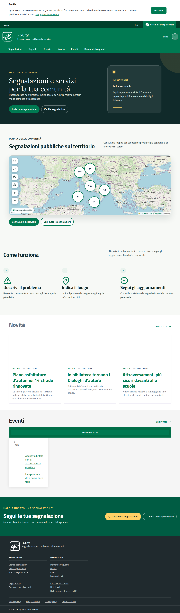

> Screenshot reale del front office FixCity, verificato il 23 novembre 2026. Per questo modulo è una superficie condivisa: il manuale non attribuisce al modulo una UI propria se non documentata dalle fonti.

# Manuale d'uso per attori

## Scopo

Comment fornisce commenti contestuali, thread, reazioni, approvazione e notifiche per modelli commentabili come Article e Ticket. Comment possiede persistenza e policy del thread; il modulo che possiede il contenuto resta owner del record commentabile.

## Attori e capacita'

| Attore | Capacita' verificata | Verifica |
|---|---|---|
| Ospite | Puo' creare commenti solo se `comments.allow_anonymous_comments` e' true; con la configurazione owner verificata (false) e' N/A. Puo' vedere commenti approvati. | [CommentPolicy](../app/Policies/CommentPolicy.php#L17-L24), [config](../config/comments.php#L89-L91). |
| Utente normale autenticato | Se implementa `CanComment`, puo' creare commenti e reagire; puo' modificare/cancellare i propri commenti e vedere i propri non approvati. | [CommentPolicy](../app/Policies/CommentPolicy.php#L26-L64), [FrontOfficeCommentThreadTest](../tests/Feature/FrontOfficeCommentThreadTest.php#L61-L104). |
| Utente in gruppo/ruolo | N/A verificato come bypass basato su ruolo. La policy usa il contratto `CanComment`, autore e lista di approvatori, non un ruolo generico. | [CommentPolicy](../app/Policies/CommentPolicy.php#L66-L128). |
| Admin | N/A verificato come bypass automatico. Le azioni di moderazione richiedono di essere un approving user. | [CommentPolicy](../app/Policies/CommentPolicy.php#L66-L74); [ListCommentsTest](../tests/Feature/Filament/Pages/ListCommentsTest.php#L36-L47). |
| Super-admin | N/A verificato come bypass automatico della policy Comment. | [AdminPanelProvider](../app/Providers/Filament/AdminPanelProvider.php#L10-L17); [CommentPolicy](../app/Policies/CommentPolicy.php). |
| Operatore/moderatore | Puo' approvare o rifiutare se risolto come approving user; il solo titolo di operatore/moderatore e' N/A verificato. | [CommentPolicy](../app/Policies/CommentPolicy.php#L66-L74). |

## Flussi principali

1. Un modello implementa `Commentable` e usa `HasComments`; un utente commentatore implementa `CanComment`.
2. Il commentatore invia un commento dal widget front office; il testo viene validato/sanitizzato e il commento viene persistito.
3. La configurazione decide l'approvazione automatica; in alternativa un approving user puo' approvare o rifiutare.
4. Un commento approvato e' visibile a chiunque; un commento non approvato e' visibile all'autore o all'approvatore.
5. L'autore puo' gestire il proprio commento e la propria reazione; la moderazione usa il resource Filament Comment.

## Prerequisiti

- Modello commentabile con i contratti/concern Comment richiesti.
- Utente autenticato che implementi `CanComment` per i flussi non anonimi.
- Configurazione `comments.allow_anonymous_comments` e `comments.automatically_approve_all_comments` coerente con il comportamento desiderato.
- Per la moderazione: approvatori risolti da `getApprovingUsers()` e pannello/resource disponibili.

## Limiti e casi non supportati

- L'utente autenticato non puo' commentare se il modello utente non implementa `CanComment`.
- L'accesso di admin o super-admin non e' implicito nella policy Comment.
- La policy della reazione consente la cancellazione solo al proprietario della reazione: [ReactionPolicy](../app/Policies/ReactionPolicy.php#L10-L26).
- Non va assunto che `CommentConfigData::$autoApproveAll` descriva da solo il runtime: l'Action legge la chiave config `comments.automatically_approve_all_comments`.
- Le rotte web del modulo sono vuote; l'esposizione front office dipende dai widget e dall'host del contenuto.

## Riferimenti owner

- [README](README.md)
- [native comments engine](native-comments-engine.md)
- [CommentPolicy](../app/Policies/CommentPolicy.php)
- [ReactionPolicy](../app/Policies/ReactionPolicy.php)
- [config comments](../config/comments.php)
- [FrontOfficeCommentThreadTest](../tests/Feature/FrontOfficeCommentThreadTest.php)
- [ListCommentsTest](../tests/Feature/Filament/Pages/ListCommentsTest.php)

